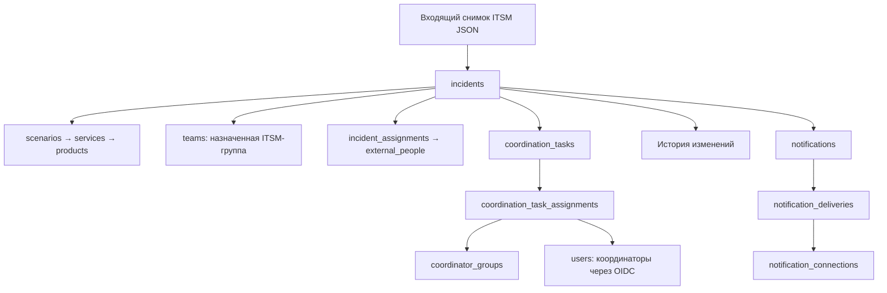

# MTS Incident Control Center — документация базы данных

> **Версия модели:** v5 · **СУБД:** PostgreSQL · **Формат диаграммы:** DBML для dbdiagram.io  
> **Основной источник схемы:** `mts_incidents_v5.dbml` · **Исходные данные для интеграции:** `character_problems.json`, `incidents_attributes.json`  
> **Состояние документа:** документация **текущего проекта**, а не утверждение о готовой production-реализации. Там, где одного DBML недостаточно, требования к миграциям и приложению вынесены отдельно.

## Содержание и порядок чтения

- **Разделы 1–3** — зачем база нужна, границы ITSM и нашего приложения, схема отношений, соглашения по типам.
- **Раздел 4** — **полный словарь всех 29 таблиц и 219 полей**, включая PK/FK, индексы и проверки.
- **Раздел 5** — все 11 enum, смысл статусов и правила жизненного цикла.
- **Раздел 6** — восемь сквозных процессов: импорт, обновление, назначение, перенаправление, завершение, уведомления.
- **Раздел 7** — какие данные храним, а какие вычисляем для дашборда.
- **Раздел 8** — **соответствие каждого из 46 входных JSON-полей** нормализованной модели и ограничения обратного экспорта.
- **Разделы 9–13** — ограничения целостности, примеры SQL, индексы, безопасность и транзакционность.
- **Разделы 14–17** — интеграционные тесты, границы v5, план реализации и глоссарий.

Для быстрого знакомства читай сначала **1 → 2 → 5 → 6**, а словарь таблиц в разделе 4 используй как справочник.

## 1. Назначение и границы системы

База данных поддерживает веб-сервис координации массовых IT-инцидентов: загрузку и обновление снимков из внешней ITSM-системы, отображение инцидентов и их приоритетов, маршрутизацию к внешним ответственным, внутренние задачи координаторов, перенаправление задач между группами, аудит изменений и многоканальные уведомления.

**Главное разделение:** внешний **ITSM-инцидент** и внутренняя **задача координатора** — разные сущности с независимыми статусами, назначениями и жизненными циклами. Один инцидент может существовать без открытой задачи координатора. После завершения одной задачи по тому же инциденту при необходимости может возникнуть другая; одновременно предполагается не более одной открытой задачи.

### 1.1. Архитектурные принципы

1. **Нормализованное ядро (ориентация на 3НФ).** Люди, группы, продукты, сервисы, сценарии, инциденты, назначения и уведомления разделены по предметным сущностям. Не сохраняем вычисляемые остатки SLA, счётчики, группы дашборда и «текущего исполнителя» отдельным дублирующим столбцом.
2. **Локальные координаторы ≠ внешние сотрудники.** `users` содержит только пользователей нашего приложения, а `external_people` — людей, упомянутых в ITSM. Внешние сотрудники не имеют локальных аккаунтов приложения.
3. **Авторизация через OIDC/Keycloak.** В PostgreSQL не хранится пароль или его хеш. Связь локального аккаунта с IdP производится по паре `(identity_issuer, identity_subject)`; допуск дополнительно контролируется `users.is_active`.
4. **ITSM-группы ≠ группы координаторов.** `teams` отражает внешние группы обработки, `coordinator_groups` — внутренние рабочие группы нашего сервиса. Не смешивать их даже при похожих названиях.
5. **Текущее состояние плюс история.** Актуальные поля в `incidents`; персональные назначения и история в отдельных таблицах. Изменения после начала эксплуатации фиксируются явно; предысторию из начального снимка не выдумываем.
6. **Поток импорта — интеграционная граница.** JSON преобразуется и валидируется до записи в нормализованные таблицы. Прямой `INSERT` объектов JSON в `incidents` не предусмотрен.
7. **Расширяемость.** Для дополнительных ссылок допускается `links_data jsonb`; параметры внешних каналов уведомлений находятся в `connection_metadata jsonb`. Это осознанные JSONB-поля внутри преимущественно реляционной модели.

### 1.2. Что входит и не входит в модель

**Входит:** инциденты и их атрибуты, справочники, внешние исполнители и команды, аккаунты координаторов, координационные задачи и перенаправления, связи между инцидентами, история изменений, подписки на приоритеты, уведомления и результаты доставки.

**Не входит в v5:** хранение паролей, внутреннее делегирование работы руководителем своим подчинённым, телеметрия Grafana/Loki, реальные измерения воздействия на клиентов, оценки ETA, полная история исходной ITSM до первого импорта, AI-чаты и результаты анализа ИИ, журнал всех попыток повторной доставки, универсальный источник событий с неизменяемым `event_id`.

### 1.3. Четыре понятия, которые нельзя путать

| Понятие | Таблица/поле | Значение |
|---|---|---|
| ITSM-группа, на которой находится инцидент | `incidents.assigned_team_id → teams.id` | Значение исходного `assignedGroupName`; это **назначенная группа**, не проект |
| Внешний ответственный человек | активная запись `incident_assignments` | Например, руководитель сервиса; вход в наш продукт ему не нужен |
| Внутренняя группа координаторов | `coordinator_groups` | Команда распределения задач **внутри** нашего продукта |
| Координатор, которому досталась задача | активная запись `coordination_task_assignments.coordinator_user_id` | Авторизованный `users`, выбирается backend; может быть `NULL`, если задача ожидает распределения внутри группы |

## 2. Обзор структуры и связей

**Всего:** 29 таблиц, 11 enum-типов. Имена всех таблиц — во множественном числе; поля — `snake_case`.

| Домен | Таблицы | Для чего |
|---|---|---|
| Учётные записи и ITSM-организация | `users`, `external_people`, `teams`, `team_members` | Разделение логинов приложения и людей/групп ITSM |
| Координационная организация | `coordinator_groups`, `coordinator_group_members` | Рабочие группы координаторов и их состав |
| Продуктовый каталог | `products`, `services`, `scenarios` | Иерархия затронутых объектов и владельцы |
| Справочники | `priority_levels`, `receiving_channels`, `incident_state_reasons` | Переиспользуемые значения |
| Ядро инцидентов | `incidents`, `incident_source_attributes`, `incident_hierarchies`, `incident_links` | Текущие данные, оригинальные признаки и отношения |
| Назначение инцидентов | `incident_assignments` | Передача ITSM-инцидента внешнему человеку |
| Работа координаторов | `coordination_tasks`, `coordination_task_assignments` | Независимая задача и история маршрутизации |
| Аудит | `incident_status_changes`, `incident_priority_changes`, `incident_assigned_team_changes`, `incident_deadline_changes` | Изменения ключевых параметров |
| Уведомления | `notification_types`, `notification_event_types`, `notification_connections`, `notification_connection_priorities`, `notifications`, `notification_deliveries` | Каналы, правила, сообщения, доставки |

### 2.1. Основные кратности

| Связь | Кратность | Примечание |
|---|---|---|
| `products → services` | 1:N | Сервис относится к одному продукту |
| `services → scenarios` | 1:N | Сценарий относится к одному сервису |
| `scenarios → incidents` | 1:N | У инцидента ровно один `scenario_id` по v5 |
| `teams ↔ external_people` | M:N | Через `team_members`; членство нельзя достоверно восстановить только из тестового JSON |
| `coordinator_groups ↔ users` | M:N | Через `coordinator_group_members` |
| `incidents → incident_assignments` | 1:N в истории | В текущий момент предполагается не более одной незавершённой записи |
| `incidents → coordination_tasks` | 1:N во времени | Одновременно предполагается не более одной `open` |
| `coordination_tasks → coordination_task_assignments` | 1:N | Каждое перенаправление создаёт новую запись |
| `incidents → incident_hierarchies` | 1:N как родитель, 0:1 как ребёнок | Иерархия «дерево», циклы запрещаются дополнительно |
| `incidents ↔ incidents` | M:N | Через `incident_links`, типизированные связи |
| `users → notification_connections` | 1:N | Возможны несколько подключений одного типа |
| `notifications → notification_deliveries` | 1:N | Отдельный результат по каждому подключению |

### 2.2. Ключевая схема процессов



## 3. Стандарты полей и чтение схемы

| Элемент | Правило |
|---|---|
| Первичные ключи | Обычно внутренний `bigint` с `increment`; в таблицах связи может быть составной ключ |
| Внешние ключи | Суффикс `_id`; внешние ключи на `users` применяются только к координаторам, на `external_people` — к ITSM-сотрудникам |
| Время | `timestamptz` (логически UTC; вывод в часовом поясе пользователя) |
| `created_at` | Время добавления строки в **нашу БД**, не равно `submitDate` инцидента |
| `updated_at` | Время изменения строки в **нашей БД**; `DEFAULT now()` не обновляет его при `UPDATE` автоматически |
| `NULL` | Неизвестное/отсутствующее значение, которое не следует подменять фиктивным |
| История | Строки `incident_*_changes` предполагаются append-only; в них `created_at` — время фиксации события у нас |
| Имена из JSON | Сохраняем в собственном `snake_case`; отображаемые строковые значения сопоставляем со справочниками |

**Важное различие:** `submitted_at` — время регистрации инцидента в ITSM; `completed_at` — время перевода в `Resolved`; `created_at` — время создания строки в нашей БД; `assigned_at` — время назначения конкретного человека/координатора, если оно известно.

## 4. Полный словарь таблиц и полей

Ниже описаны **все таблицы и все физические поля именно текущей v5**, а не предполагаемой следующей версии. Статусы, PK/FK, `NOT NULL`, значения по умолчанию и индексы перечислены в той степени, в которой они объявлены DBML. После словаря приведены бизнес-ограничения, не обеспеченные одним лишь DBML.

### 4.1. Пользователи приложения — `users`

Только реальные пользователи нашего сервиса: координаторы, прошедшие аутентификацию через OIDC/Keycloak. Локальных паролей и поля `role` здесь нет. Аккаунт координатора определяется внешней идентичностью и локальным разрешением на доступ.

| Поле | Тип DBML | Ограничения и значение по умолчанию | Значение |
|---|---|---|---|
| `id` | `bigint` | PK, increment | Внутренний PK аккаунта координатора |
| `identity_issuer` | `varchar(512)` | not null | Значение `iss` из проверенного OIDC-токена; пространство идентификации |
| `identity_subject` | `varchar(255)` | not null | Стабильный `sub` внутри `iss`; основной внешний идентификатор |
| `login` | `varchar(120)` | not null | Читаемый логин (`preferred_username`); не использовать как уникальный идентификатор |
| `display_name` | `varchar(255)` | not null | Имя для интерфейса |
| `is_active` | `boolean` | not null, DEFAULT true | Локальный флаг допуска к системе; не заменяет проверку токена |
| `created_at` | `timestamptz` | not null, DEFAULT `now()` | Когда строка создана в нашей БД |
| `updated_at` | `timestamptz` | not null, DEFAULT `now()` | Когда строка последний раз изменялась в нашей БД |

**Индексы из DBML:** `(identity_issuer, identity_subject) [unique]`.


### 4.2. Внешние сотрудники ITSM — `external_people`

Справочник людей, встречающихся в исходных данных ITSM: инициаторы, назначенные исполнители, владельцы продуктов и сервисов. Эти записи **не являются аккаунтами** нашего продукта.

| Поле | Тип DBML | Ограничения и значение по умолчанию | Значение |
|---|---|---|---|
| `id` | `bigint` | PK, increment | PK записи внешнего человека |
| `source_system` | `varchar(64)` | not null, DEFAULT 'itsm' | Источник внешней идентичности, обычно `itsm` |
| `external_login` | `varchar(120)` | not null | Логин сотрудника во внешней системе, не пароль и не аккаунт приложения |
| `display_name` | `varchar(255)` | not null | Отображаемое имя внешнего сотрудника |
| `created_at` | `timestamptz` | not null, DEFAULT `now()` | Когда строка создана в нашей БД |
| `updated_at` | `timestamptz` | not null, DEFAULT `now()` | Когда строка последний раз изменялась в нашей БД |

**Индексы из DBML:** `(source_system, external_login) [unique]`.


### 4.3. Внешние группы ITSM — `teams`

Справочник групп обработки инцидентов из `assignedGroupName`. Группа координаторов ITSM тоже может быть записью здесь; эта таблица не означает продукт или проект.

| Поле | Тип DBML | Ограничения и значение по умолчанию | Значение |
|---|---|---|---|
| `id` | `bigint` | PK, increment | PK ITSM-группы |
| `name` | `varchar(255)` | not null, unique | Наименование ITSM-группы из `assignedGroupName` |
| `kind` | `team_kind` | not null, DEFAULT 'resolution' | Тип группы: координационная или группа устранения |
| `created_at` | `timestamptz` | not null, DEFAULT `now()` | Когда строка создана в нашей БД |
| `updated_at` | `timestamptz` | not null, DEFAULT `now()` | Когда строка последний раз изменялась в нашей БД |


### 4.4. Членство внешних сотрудников в ITSM-группах — `team_members`

Связь многие-ко-многим между `teams` и `external_people`. Должна заполняться из авторитетного справочника или административно: одиночная выгрузка назначения не доказывает членство человека в группе.

| Поле | Тип DBML | Ограничения и значение по умолчанию | Значение |
|---|---|---|---|
| `id` | `bigint` | PK, increment | PK членства |
| `team_id` | `bigint` | not null, FK → teams.id | Группа ITSM |
| `external_person_id` | `bigint` | not null, FK → external_people.id | Внешний сотрудник, состоящий в группе |
| `role` | `team_member_role` | not null, DEFAULT 'member' | Роль в группе: член или руководитель |
| `is_active` | `boolean` | not null, DEFAULT true | Участвует ли членство в текущем справочнике |
| `created_at` | `timestamptz` | not null, DEFAULT `now()` | Когда строка создана в нашей БД |
| `updated_at` | `timestamptz` | not null, DEFAULT `now()` | Когда строка последний раз изменялась в нашей БД |

**Индексы из DBML:** `(team_id, external_person_id) [unique]`.


### 4.5. Группы координаторов нашего приложения — `coordinator_groups`

Независимые рабочие группы маршрутизации внутренних задач. Не смешивать с `teams`. Необязательная связь `source_team_id` позволяет настроить первоначальное распределение по ITSM-группе.

| Поле | Тип DBML | Ограничения и значение по умолчанию | Значение |
|---|---|---|---|
| `id` | `bigint` | PK, increment | PK внутренней группы |
| `name` | `varchar(255)` | not null, unique | Название группы координаторов |
| `description` | `text` | — | Назначение группы/компетенции |
| `source_team_id` | `bigint` | FK → teams.id | Опциональное соответствие группе из ITSM для первоначальной маршрутизации; не гарантирует взаимно-однозначность |
| `is_active` | `boolean` | not null, DEFAULT true | Можно ли назначать группе новые задачи |
| `created_at` | `timestamptz` | not null, DEFAULT `now()` | Когда строка создана в нашей БД |
| `updated_at` | `timestamptz` | not null, DEFAULT `now()` | Когда строка последний раз изменялась в нашей БД |

**Индексы из DBML:** `source_team_id`.


### 4.6. Состав групп координаторов — `coordinator_group_members`

Многие-ко-многим: один координатор может состоять в нескольких внутренних группах; группа может содержать нескольких координаторов. Для распределения backend учитывает активность участника и аккаунта.

| Поле | Тип DBML | Ограничения и значение по умолчанию | Значение |
|---|---|---|---|
| `id` | `bigint` | PK, increment | PK членства |
| `coordinator_group_id` | `bigint` | not null, FK → coordinator_groups.id | Внутренняя группа координаторов |
| `user_id` | `bigint` | not null, FK → users.id | Координатор приложения |
| `is_active` | `boolean` | not null, DEFAULT true | Можно ли выбирать пользователя при распределении задачи |
| `created_at` | `timestamptz` | not null, DEFAULT `now()` | Когда строка создана в нашей БД |
| `updated_at` | `timestamptz` | not null, DEFAULT `now()` | Когда строка последний раз изменялась в нашей БД |

**Индексы из DBML:** `(coordinator_group_id, user_id) [unique]`; `(user_id, is_active)`.


### 4.7. Продукты — `products`

Продукт, к которому относится сервис и инцидент. Можно указать внешнего руководителя продукта как возможного адресата маршрутизации.

| Поле | Тип DBML | Ограничения и значение по умолчанию | Значение |
|---|---|---|---|
| `id` | `bigint` | PK, increment | PK продукта |
| `name` | `varchar(255)` | not null, unique | Нормализованное наименование продукта из `productName` |
| `description` | `text` | — | Произвольное описание продукта (добавлено в v2) |
| `owner_external_person_id` | `bigint` | FK → external_people.id | Ответственный руководитель продукта из ITSM; в исходном JSON не задан явно |
| `created_at` | `timestamptz` | not null, DEFAULT `now()` | Когда строка создана в нашей БД |
| `updated_at` | `timestamptz` | not null, DEFAULT `now()` | Когда строка последний раз изменялась в нашей БД |


### 4.8. Сервисы — `services`

Сервисы внутри конкретного продукта, со своим внешним владельцем. В исходном JSON строка `service` часто содержит префикс `[Название продукта]`; в таблице хранится нормализованное локальное название сервиса.

| Поле | Тип DBML | Ограничения и значение по умолчанию | Значение |
|---|---|---|---|
| `id` | `bigint` | PK, increment | PK сервиса |
| `product_id` | `bigint` | not null, FK → products.id | Продукт-владелец сервиса |
| `name` | `varchar(255)` | not null | Локальное имя сервиса в пределах продукта |
| `owner_external_person_id` | `bigint` | FK → external_people.id | Руководитель сервиса; заполняется отдельно, отсутствует в тестовом JSON |
| `created_at` | `timestamptz` | not null, DEFAULT `now()` | Когда строка создана в нашей БД |
| `updated_at` | `timestamptz` | not null, DEFAULT `now()` | Когда строка последний раз изменялась в нашей БД |

**Индексы из DBML:** `(product_id, name) [unique]`.


### 4.9. Сценарии сервисов — `scenarios`

Более конкретная бизнес- или техническая функция сервиса. Инцидент в v5 обязательно ссылается на сценарий.

| Поле | Тип DBML | Ограничения и значение по умолчанию | Значение |
|---|---|---|---|
| `id` | `bigint` | PK, increment | PK сценария |
| `service_id` | `bigint` | not null, FK → services.id | Сервис, к которому относится сценарий |
| `name` | `varchar(255)` | not null | Имя сценария из `scenarioName` |
| `description` | `text` | — | Описание сценария, отсутствует в исходной тестовой выгрузке |
| `created_at` | `timestamptz` | not null, DEFAULT `now()` | Когда строка создана в нашей БД |
| `updated_at` | `timestamptz` | not null, DEFAULT `now()` | Когда строка последний раз изменялась в нашей БД |

**Индексы из DBML:** `(service_id, name) [unique]`.


### 4.10. Справочник приоритетов — `priority_levels`

Четыре фиксированных уровня: 1 — низкий, 2 — средний, 3 — высокий, 4 — наивысший. Используется как FK инцидентами и фильтрами уведомлений; не является вычисляемым значением в схеме.

| Поле | Тип DBML | Ограничения и значение по умолчанию | Значение |
|---|---|---|---|
| `id` | `int` | PK | Числовой идентификатор, совпадает с входным `priorityId` 1–4 |
| `code` | `varchar(32)` | not null, unique | Машинный код: `low`, `medium`, `high`, `highest` |
| `name` | `varchar(64)` | not null | Человекочитаемое название приоритета |
| `created_at` | `timestamptz` | not null, DEFAULT `now()` | Когда строка создана в нашей БД |
| `updated_at` | `timestamptz` | not null, DEFAULT `now()` | Когда строка последний раз изменялась в нашей БД |


### 4.11. Каналы регистрации инцидентов — `receiving_channels`

Справочник того, откуда инцидент был зарегистрирован в ITSM (`receivingChannel`). Не путать с каналом **доставки уведомления** (`notification_types`).

| Поле | Тип DBML | Ограничения и значение по умолчанию | Значение |
|---|---|---|---|
| `id` | `bigint` | PK, increment | PK канала регистрации |
| `name` | `varchar(255)` | not null, unique | Значение входного `receivingChannel` |
| `created_at` | `timestamptz` | not null, DEFAULT `now()` | Когда строка создана в нашей БД |
| `updated_at` | `timestamptz` | not null, DEFAULT `now()` | Когда строка последний раз изменялась в нашей БД |


### 4.12. Причины / подстатусы ITSM — `incident_state_reasons`

Справочник `stateReason` / `stateReasonId`: дубль, внешняя обработка, постоянное решение и т.п. Причина может встречаться и у активного инцидента.

| Поле | Тип DBML | Ограничения и значение по умолчанию | Значение |
|---|---|---|---|
| `id` | `bigint` | PK, increment | Локальный PK причины |
| `source_code` | `varchar(30)` | not null, unique | Внешний код из `stateReasonId` — строковый |
| `name` | `varchar(255)` | — | Описание причины из `stateReason`; может быть `NULL` |
| `created_at` | `timestamptz` | not null, DEFAULT `now()` | Когда строка создана в нашей БД |
| `updated_at` | `timestamptz` | not null, DEFAULT `now()` | Когда строка последний раз изменялась в нашей БД |


### 4.13. Инциденты — центральная таблица — `incidents`

Нормализованное текущее состояние ITSM-инцидента: идентичность, место сбоя, важность, жизненный цикл, описание, сроки и ссылки. Не содержит дублирующих полей «текущий исполнитель координатора» или «оставшееся SLA».

| Поле | Тип DBML | Ограничения и значение по умолчанию | Значение |
|---|---|---|---|
| `id` | `bigint` | PK, increment | Внутренний PK инцидента |
| `number` | `varchar(32)` | not null, unique | Публичный номер из входного `id`; уникальный ключ идемпотентного импорта |
| `kind` | `incident_kind` | not null, DEFAULT 'mass' | Тип инцидента; сейчас только `mass` (`МИ`) |
| `scenario_id` | `bigint` | not null, FK → scenarios.id | Нормализованная привязка к сценарию; продукт и сервис получаем через него |
| `initiator_external_person_id` | `bigint` | not null, FK → external_people.id | Инициатор из внешних сотрудников ITSM |
| `receiving_channel_id` | `bigint` | not null, FK → receiving_channels.id | Канал регистрации инцидента |
| `assigned_team_id` | `bigint` | FK → teams.id | Текущая назначенная ITSM-группа; импорт `assignedGroupName` |
| `status` | `incident_status` | not null | Текущий жизненный цикл ITSM, преобразованный из `stateId` |
| `state_reason_id` | `bigint` | FK → incident_state_reasons.id | Текущая причина/подстатус |
| `priority_level_id` | `int` | not null, FK → priority_levels.id | Текущий приоритет из входного `priorityId` |
| `impact` | `impact_level` | not null | Степень влияния из `impactId` / `impact` |
| `urgency` | `urgency_level` | not null | Срочность из `urgencyId` / `urgency` |
| `audience` | `service_audience` | not null | Тип сервиса по кругу влияния из `serviceTypeId` / `serviceType` |
| `header` | `varchar(500)` | not null | Заголовок инцидента |
| `description` | `text` | not null | Полный текст симптомов/проблемы |
| `short_description` | `text` | — | Краткое описание из JSON |
| `page_url` | `text` | — | Основная ссылка на **страницу инцидента** в ITSM; не равна `productUrl` |
| `links_data` | `jsonb` | not null, DEFAULT '{}' | JSON-объект именованных дополнительных URL: `{"Grafana":"https://…"}` |
| `solution` | `text` | — | Описание решения; по принятому правилу при `assigned` и `in_progress` только `NULL` |
| `submitted_at` | `timestamptz` | not null | Регистрация в ITSM (`submitDate`), не время импорта |
| `deadline_at` | `timestamptz` | — | Плановый срок устранения (`deadline`); может отсутствовать |
| `completed_at` | `timestamptz` | — | Момент перевода в `resolved` (`completionDate`); не дата закрытия |
| `needs_follow_up` | `boolean` | — | Нужны ли дальнейшие действия по устранению последствий (`isNeedUp`); `NULL` = нет данных |
| `created_at` | `timestamptz` | not null, DEFAULT `now()` | Когда строка создана в нашей БД |
| `updated_at` | `timestamptz` | not null, DEFAULT `now()` | Когда строка последний раз изменялась в нашей БД |

**Индексы из DBML:** `(status, priority_level_id)`; `deadline_at`; `scenario_id`; `initiator_external_person_id`; `assigned_team_id`.

**CHECK из DBML:** ``status NOT IN ('assigned', 'in_progress') OR solution IS NULL` [name: 'chk_active_incident_has_no_solution']`; ``jsonb_typeof(links_data) = 'object'` [name: 'chk_links_data_object']`.


### 4.14. Дополнительные атрибуты исходного JSON — `incident_source_attributes`

Расширение инцидента 1:1 с исходными техническими идентификаторами и флагами. Эти признаки не следует автоматически превращать в достоверные отношения между инцидентами. Таблица **не** является полным оригинальным JSON-снимком.

| Поле | Тип DBML | Ограничения и значение по умолчанию | Значение |
|---|---|---|---|
| `incident_id` | `bigint` | PK, FK → incidents.id | PK и FK к инциденту; обеспечивает 1:1 |
| `source_sys_id` | `varchar(32)` | unique | Внешний `sysId` записи ITSM |
| `source_product_id` | `varchar(64)` | — | Исходный `productId`; не использовать как безусловно уникальный справочник |
| `source_product_master_id` | `varchar(64)` | — | Исходный `productMasterId`, например `BI_3244` |
| `source_service_id` | `varchar(64)` | — | Исходный `serviceId` |
| `source_product_url` | `text` | — | Входной `productUrl`; ссылка именно на продукт, не на инцидент |
| `source_last_assignment_to_team_at` | `timestamptz` | — | Входной `lastAssignmentToTeamDateTime`; назначение **группе**, не человеку |
| `waiting_exit_at` | `timestamptz` | — | Входной `waitingExitDate`; техническую дату `0001-01-01` приводить к `NULL` |
| `elimination_type` | `varchar(255)` | — | Входной `eliminationType`; в тестовой выгрузке `NULL` |
| `elimination_type_code` | `varchar(64)` | — | Входной `eliminationTypeId`; в тестовой выгрузке `NULL` |
| `source_is_effect` | `boolean` | not null, DEFAULT false | Исходный флаг `isEffect`; не подменяет вычисленные связи |
| `source_is_reason` | `boolean` | not null, DEFAULT false | Исходный флаг `isReason`; не подменяет вычисленные связи |
| `source_is_duplicate` | `boolean` | not null, DEFAULT false | Исходный флаг `isDouble` |
| `source_is_master` | `boolean` | not null, DEFAULT false | Исходный флаг `isMaster` |
| `source_is_root` | `boolean` | not null, DEFAULT false | Исходный флаг `isRootIncident` |
| `created_at` | `timestamptz` | not null, DEFAULT `now()` | Когда строка создана в нашей БД |
| `updated_at` | `timestamptz` | not null, DEFAULT `now()` | Когда строка последний раз изменялась в нашей БД |


### 4.15. Строгая иерархия инцидентов — `incident_hierarchies`

Прямое отношение «один непосредственный родитель — много детей». Дочерний инцидент может иметь не более одного непосредственного родителя. Запрет циклов нужен дополнительно.

| Поле | Тип DBML | Ограничения и значение по умолчанию | Значение |
|---|---|---|---|
| `child_incident_id` | `bigint` | PK, FK → incidents.id | PK/FK дочернего инцидента: не больше одного непосредственного родителя |
| `parent_incident_id` | `bigint` | not null, FK → incidents.id | FK непосредственного родителя |
| `linked_by_user_id` | `bigint` | FK → users.id | Координатор, создавший связь (если применимо) |
| `created_at` | `timestamptz` | not null, DEFAULT `now()` | Когда строка создана в нашей БД |
| `updated_at` | `timestamptz` | not null, DEFAULT `now()` | Когда строка последний раз изменялась в нашей БД |

**Индексы из DBML:** `parent_incident_id`.

**CHECK из DBML:** ``parent_incident_id <> child_incident_id` [name: 'chk_hierarchy_not_self']`.


### 4.16. Прочие связи между инцидентами — `incident_links`

Типизированные связи: просто связанные инциденты, причинность, дубликат. В отличие от `incident_hierarchies`, это не дерево и не предполагает единственного родителя.

| Поле | Тип DBML | Ограничения и значение по умолчанию | Значение |
|---|---|---|---|
| `id` | `bigint` | PK, increment | PK связи |
| `source_incident_id` | `bigint` | not null, FK → incidents.id | Исходный инцидент отношения |
| `target_incident_id` | `bigint` | not null, FK → incidents.id | Целевой инцидент отношения |
| `kind` | `incident_link_kind` | not null | Тип отношения (`related_to`, `causes`, `duplicate_of`) |
| `created_at` | `timestamptz` | not null, DEFAULT `now()` | Когда строка создана в нашей БД |
| `updated_at` | `timestamptz` | not null, DEFAULT `now()` | Когда строка последний раз изменялась в нашей БД |

**Индексы из DBML:** `(source_incident_id, target_incident_id, kind) [unique]`.

**CHECK из DBML:** ``source_incident_id <> target_incident_id` [name: 'chk_link_not_self']`.


### 4.17. Передача инцидентов внешним ответственным — `incident_assignments`

История персонального назначения ITSM-инцидента **внешнему человеку**, например руководителю сервиса. При переназначении старая строка закрывается (`ended_at`), создаётся новая. Это **не** назначение внутреннему координатору.

| Поле | Тип DBML | Ограничения и значение по умолчанию | Значение |
|---|---|---|---|
| `id` | `bigint` | PK, increment | PK акта персонального назначения |
| `incident_id` | `bigint` | not null, FK → incidents.id | Инцидент из ITSM |
| `assignee_external_person_id` | `bigint` | not null, FK → external_people.id | Внешний назначенный сотрудник/руководитель |
| `assigned_by_user_id` | `bigint` | FK → users.id | Наш координатор, назначивший человека; `NULL` для внешнего изменения/импорта |
| `assigned_at` | `timestamptz` | — | Время назначения человеку, если известно; начальный JSON его не сообщает |
| `ended_at` | `timestamptz` | — | Время завершения назначения; `NULL` означает активное |
| `created_at` | `timestamptz` | not null, DEFAULT `now()` | Когда строка создана в нашей БД |
| `updated_at` | `timestamptz` | not null, DEFAULT `now()` | Когда строка последний раз изменялась в нашей БД |

**Индексы из DBML:** `(incident_id, ended_at)`; `(assignee_external_person_id, ended_at)`.

**CHECK из DBML:** ``ended_at IS NULL OR assigned_at IS NULL OR ended_at >= assigned_at` [name: 'chk_assignment_end_after_start']`.


### 4.18. Внутренние задачи координаторов — `coordination_tasks`

Самостоятельная внутренняя задача нашего приложения на обработку/маршрутизацию инцидента. Её `status` не тождествен `incidents.status`. На один инцидент допустимы последовательные задачи, но предполагается не больше одной открытой одновременно.

| Поле | Тип DBML | Ограничения и значение по умолчанию | Значение |
|---|---|---|---|
| `id` | `bigint` | PK, increment | PK внутренней задачи |
| `incident_id` | `bigint` | not null, FK → incidents.id | ITSM-инцидент, ради которого задача создана |
| `status` | `coordination_task_status` | not null, DEFAULT 'open' | Статус всего процесса координации (`open`, `completed`, `cancelled`) |
| `finished_at` | `timestamptz` | — | Фактическое завершение/отмена задачи; `NULL` для `open` |
| `created_at` | `timestamptz` | not null, DEFAULT `now()` | Когда строка создана в нашей БД |
| `updated_at` | `timestamptz` | not null, DEFAULT `now()` | Когда строка последний раз изменялась в нашей БД |

**Индексы из DBML:** `(incident_id, status)`.

**CHECK из DBML:** ``(status = 'open' AND finished_at IS NULL) OR (status IN ('completed', 'cancelled') AND finished_at IS NOT NULL)` [name: 'chk_coordination_task_finish']`.


### 4.19. Назначения и перенаправления задач координаторов — `coordination_task_assignments`

История попыток распределения внутренней задачи по группам и людям. При переадресации прежнее назначение получает `redirected` и `ended_at`, новая запись — `assigned` без `ended_at`.

| Поле | Тип DBML | Ограничения и значение по умолчанию | Значение |
|---|---|---|---|
| `id` | `bigint` | PK, increment | PK шага маршрутизации |
| `coordination_task_id` | `bigint` | not null, FK → coordination_tasks.id | Задача координатора |
| `coordinator_group_id` | `bigint` | not null, FK → coordinator_groups.id | Группа координаторов, принявшая текущий шаг |
| `coordinator_user_id` | `bigint` | FK → users.id | Координатор из группы, выбранный backend; `NULL`, если пока выбран только уровень группы |
| `status` | `coordination_assignment_status` | not null, DEFAULT 'assigned' | Статус этого назначения; не статус всей задачи |
| `assigned_by_user_id` | `bigint` | FK → users.id | Кто инициировал назначение; `NULL` при автоматическом распределении |
| `redirected_by_user_id` | `bigint` | FK → users.id | Кто перенаправил задачу |
| `redirect_reason` | `text` | — | Причина перенаправления (текст) |
| `assigned_at` | `timestamptz` | not null, DEFAULT `now()` | Когда началось назначение |
| `ended_at` | `timestamptz` | — | Когда закончилось назначение; `NULL` у активного |
| `created_at` | `timestamptz` | not null, DEFAULT `now()` | Когда строка создана в нашей БД |
| `updated_at` | `timestamptz` | not null, DEFAULT `now()` | Когда строка последний раз изменялась в нашей БД |

**Индексы из DBML:** `(coordination_task_id, ended_at)`; `(coordinator_group_id, ended_at)`; `(coordinator_user_id, ended_at)`.

**CHECK из DBML:** ``(status IN ('assigned', 'in_progress') AND ended_at IS NULL) OR (status IN ('redirected', 'completed', 'cancelled') AND ended_at IS NOT NULL)` [name: 'chk_coordination_assignment_lifecycle']`; ``ended_at IS NULL OR ended_at >= assigned_at` [name: 'chk_coordination_assignment_time']`.


### 4.20. История статусов инцидента — `incident_status_changes`

Добавляемый журнал переходов между ITSM-статусами. Начальный снимок не предоставляет неизвестную историю; журнал начинается при наблюдении изменений.

| Поле | Тип DBML | Ограничения и значение по умолчанию | Значение |
|---|---|---|---|
| `id` | `bigint` | PK, increment | PK записи аудита |
| `incident_id` | `bigint` | not null, FK → incidents.id | Изменившийся инцидент |
| `previous_status` | `incident_status` | — | Предыдущее значение; допускается `NULL` |
| `new_status` | `incident_status` | not null | Новое значение |
| `changed_at` | `timestamptz` | not null | Когда статус действительно изменился (если известно) |
| `changed_by_user_id` | `bigint` | FK → users.id | Наш координатор, выполнивший действие; `NULL` для обновлений ITSM |
| `created_at` | `timestamptz` | not null, DEFAULT `now()` | Когда строка создана в нашей БД |

**Индексы из DBML:** `(incident_id, changed_at)`.


### 4.21. История приоритета — `incident_priority_changes`

Фиксация смены `priority_level_id`, включая достижение наивысшего уровня. В исходном DBML оба значения приоритета обязательны.

| Поле | Тип DBML | Ограничения и значение по умолчанию | Значение |
|---|---|---|---|
| `id` | `bigint` | PK, increment | PK записи аудита |
| `incident_id` | `bigint` | not null, FK → incidents.id | Инцидент |
| `previous_priority_level_id` | `int` | not null, FK → priority_levels.id | Старый приоритет; обязателен |
| `new_priority_level_id` | `int` | not null, FK → priority_levels.id | Новый приоритет; обязателен |
| `changed_at` | `timestamptz` | not null | Время смены приоритета |
| `changed_by_user_id` | `bigint` | FK → users.id | Наш координатор или `NULL` для внешнего события |
| `created_at` | `timestamptz` | not null, DEFAULT `now()` | Когда строка создана в нашей БД |

**Индексы из DBML:** `(incident_id, changed_at)`.


### 4.22. История назначения ITSM-группы — `incident_assigned_team_changes`

Изменения `incidents.assigned_team_id` независимо от внутренних перенаправлений координационных задач.

| Поле | Тип DBML | Ограничения и значение по умолчанию | Значение |
|---|---|---|---|
| `id` | `bigint` | PK, increment | PK записи аудита |
| `incident_id` | `bigint` | not null, FK → incidents.id | Инцидент |
| `previous_team_id` | `bigint` | FK → teams.id | Предыдущая назначенная ITSM-группа |
| `new_team_id` | `bigint` | FK → teams.id | Новая назначенная ITSM-группа |
| `changed_at` | `timestamptz` | not null | Время смены назначенной группы |
| `changed_by_user_id` | `bigint` | FK → users.id | Наш координатор или `NULL` для импорта |
| `created_at` | `timestamptz` | not null, DEFAULT `now()` | Когда строка создана в нашей БД |

**Индексы из DBML:** `(incident_id, changed_at)`.


### 4.23. История дедлайнов — `incident_deadline_changes`

Изменения срока решения ITSM-инцидента, включая переходы в и из `NULL`.

| Поле | Тип DBML | Ограничения и значение по умолчанию | Значение |
|---|---|---|---|
| `id` | `bigint` | PK, increment | PK записи аудита |
| `incident_id` | `bigint` | not null, FK → incidents.id | Инцидент |
| `previous_deadline_at` | `timestamptz` | — | Предыдущий срок, включая `NULL` |
| `new_deadline_at` | `timestamptz` | — | Новый срок, включая `NULL` |
| `changed_at` | `timestamptz` | not null | Когда изменился дедлайн |
| `changed_by_user_id` | `bigint` | FK → users.id | Координатор-инициатор или `NULL` |
| `created_at` | `timestamptz` | not null, DEFAULT `now()` | Когда строка создана в нашей БД |

**Индексы из DBML:** `(incident_id, changed_at)`.


### 4.24. Типы каналов доставки — `notification_types`

Справочник транспорта отправки сообщений: `in_app`, `email`, `telegram`, `webhook`. Это **не** тип бизнес-события.

| Поле | Тип DBML | Ограничения и значение по умолчанию | Значение |
|---|---|---|---|
| `id` | `bigint` | PK, increment | PK канала доставки |
| `code` | `varchar(40)` | not null, unique | Стабильный код транспорта: `in_app`, `email`, `telegram`, `webhook` |
| `name` | `varchar(100)` | not null | Название канала для UI |
| `description` | `text` | — | Описание и особенности транспорта |
| `created_at` | `timestamptz` | not null, DEFAULT `now()` | Когда строка создана в нашей БД |
| `updated_at` | `timestamptz` | not null, DEFAULT `now()` | Когда строка последний раз изменялась в нашей БД |


### 4.25. Типы событий для уведомлений — `notification_event_types`

Справочник бизнес-причин оповещения: критический инцидент, назначение задачи, перенаправление, нарушение SLA и т.д.

| Поле | Тип DBML | Ограничения и значение по умолчанию | Значение |
|---|---|---|---|
| `id` | `bigint` | PK, increment | PK типа события |
| `code` | `varchar(64)` | not null, unique | Машинный код: `became_critical`, `sla_breached` и др. |
| `name` | `varchar(150)` | not null | Название события для UI |
| `description` | `text` | — | Когда/почему создаётся уведомление |
| `created_at` | `timestamptz` | not null, DEFAULT `now()` | Когда строка создана в нашей БД |
| `updated_at` | `timestamptz` | not null, DEFAULT `now()` | Когда строка последний раз изменялась в нашей БД |


### 4.26. Подключения каналов уведомлений — `notification_connections`

Сконфигурированные пользователем конечные точки доставки. Один пользователь может иметь несколько подключений одного типа. Содержит JSONB-параметры, но не должен содержать открытые секреты.

| Поле | Тип DBML | Ограничения и значение по умолчанию | Значение |
|---|---|---|---|
| `id` | `bigint` | PK, increment | PK конкретного подключения |
| `user_id` | `bigint` | not null, FK → users.id | Владелец подключения, авторизованный координатор |
| `notification_type_id` | `bigint` | not null, FK → notification_types.id | Транспорт/тип канала |
| `connection_metadata` | `jsonb` | not null, DEFAULT '{}' | JSONB-настройки конкретного транспорта (email, chat_id, endpoint, ссылки на секреты) |
| `is_active` | `boolean` | not null, DEFAULT true | Разрешена ли отправка по этому подключению |
| `created_at` | `timestamptz` | not null, DEFAULT `now()` | Когда строка создана в нашей БД |
| `updated_at` | `timestamptz` | not null, DEFAULT `now()` | Когда строка последний раз изменялась в нашей БД |

**Индексы из DBML:** `(user_id, is_active)`; `notification_type_id`.


### 4.27. Разрешённые приоритеты для подключения — `notification_connection_priorities`

Нормализованная замена массива `[1,3,4]`: каждая запись разрешает отправку событий определённого приоритета на выбранное подключение.

| Поле | Тип DBML | Ограничения и значение по умолчанию | Значение |
|---|---|---|---|
| `notification_connection_id` | `bigint` | not null, FK → notification_connections.id | FK к подключению |
| `priority_level_id` | `int` | not null, FK → priority_levels.id | Разрешённый ID приоритета 1–4 |
| `created_at` | `timestamptz` | not null, DEFAULT `now()` | Когда строка создана в нашей БД |

**Индексы из DBML:** `(notification_connection_id, priority_level_id) [pk]`.


### 4.28. Логические уведомления — `notifications`

Одно сообщение одному координатору по одному инциденту и одному типу события. Содержимое сохраняется как исторический снимок текста для пользователя.

| Поле | Тип DBML | Ограничения и значение по умолчанию | Значение |
|---|---|---|---|
| `id` | `bigint` | PK, increment | PK уведомления |
| `incident_id` | `bigint` | not null, FK → incidents.id | Инцидент-источник уведомления |
| `recipient_user_id` | `bigint` | not null, FK → users.id | Пользователь-координатор, которому оно адресовано |
| `event_type_id` | `bigint` | not null, FK → notification_event_types.id | Бизнес-событие, вызвавшее оповещение |
| `title` | `varchar(255)` | not null | Заголовок уведомления |
| `body` | `text` | not null | Текст, сохранённый в момент создания, а не вычисляемый каждый раз |
| `created_at` | `timestamptz` | not null, DEFAULT `now()` | Когда строка создана в нашей БД |
| `updated_at` | `timestamptz` | not null, DEFAULT `now()` | Когда строка последний раз изменялась в нашей БД |
| `read_at` | `timestamptz` | — | Время прочтения внутри приложения; `NULL` — не прочитано |

**Индексы из DBML:** `(recipient_user_id, read_at, created_at)`; `(incident_id, created_at)`.


### 4.29. Доставка уведомлений по каналам — `notification_deliveries`

Каждая запись — текущий результат доставки одного логического уведомления через одно подключение. Отдельная таблица попыток повторной отправки **в v5 отсутствует**.

| Поле | Тип DBML | Ограничения и значение по умолчанию | Значение |
|---|---|---|---|
| `id` | `bigint` | PK, increment | PK доставки |
| `notification_id` | `bigint` | not null, FK → notifications.id | Логическое уведомление |
| `notification_connection_id` | `bigint` | not null, FK → notification_connections.id | Канал/подключение получателя |
| `status` | `notification_delivery_status` | not null, DEFAULT 'pending' | Состояние отправки: `pending`, `sending`, `sent`, `failed` |
| `external_message_id` | `varchar(255)` | — | ID сообщения на стороне внешнего провайдера |
| `attempted_at` | `timestamptz` | — | Когда пробовали отправить |
| `sent_at` | `timestamptz` | — | Когда канал подтвердил отправку |
| `failure_reason` | `text` | — | Причина ошибки последней/текущей отправки |
| `created_at` | `timestamptz` | not null, DEFAULT `now()` | Когда строка создана в нашей БД |
| `updated_at` | `timestamptz` | not null, DEFAULT `now()` | Когда строка последний раз изменялась в нашей БД |

**Индексы из DBML:** `(notification_id, notification_connection_id) [unique]`; `(status, created_at)`.


## 5. Перечисления (ENUM) и бизнес-семантика

В текущем DBML содержится **11 enum-типов**. Значения PostgreSQL enum — технические коды, а не русские подписи UI. Список допускаемых значений ограничивает домен колонки, **но сам по себе не проверяет допустимость перехода между статусами**.

### 5.1. `incident_status`: жизненный цикл ITSM

| Значение в БД | Исходный `stateId` | Исходный `stateEnum` | Отображение | Процессное значение |
|---|---:|---|---|---|
| `assigned` | 0 | `Assigned` | Назначен | Инцидент назначен, работа ещё не завершена |
| `in_progress` | 2 | `WorkInProgress` | Выполняется | Инцидент находится в работе |
| `resolved` | 7 | `Resolved` | Завершен | Проблема устранена; возврат в работу возможен |
| `closed` | 10 | `Closed` | Закрыт | Работа закончена окончательно; при новом повторном сбое оформляется новый инцидент |
| `research` | 20 | `Research` | Исследование ситуации | Техническую проблему устранили, идёт дальнейший анализ |

**Источник бизнес-правил:** разъяснения экспертов кейса. Словарь `incidents_attributes.json` меняет местами коды `7` и `10`; при интеграции использовать соответствие **фактической выгрузки** и подтверждённые разъяснения. Статус `20` в словаре отсутствует, но в данных встречается.

**Не следует выдумывать переходы**, которые не были определены кейсом. Сейчас известно: `resolved` может вернуться в работу, `closed` считается терминальным. Формальная матрица всех остальных переходов **не зафиксирована** в v5 и должна определяться доменной логикой приложения, а не выводиться из набора пяти enum-значений.

`completed_at` обозначает **время перевода в `resolved`**. Оно не обязательно равно моменту окончательного закрытия (`closed`) и может оставаться заполненным, если инцидент позже был переведён в `research`.

### 5.2. `coordination_task_status`: состояние внутренней задачи

| Значение | Что означает | `finished_at` |
|---|---|---|
| `open` | Задача активна, координатор должен организовать обработку | `NULL` |
| `completed` | Координационная работа завершена | Обязательно заполнено |
| `cancelled` | Внутренняя задача отменена | Обязательно заполнено |

Ограничение согласованности `status` и `finished_at` объявлено в DBML. Инцидент при этом может иметь произвольный статус ITSM, если бизнес-правила приложения не накладывают дополнительного условия.

### 5.3. `coordination_assignment_status`: статус конкретного назначения

| Значение | Смысл | Запись считается действующей? |
|---|---|---|
| `assigned` | Назначена группе / человеку, работа не началась | Да, `ended_at IS NULL` |
| `in_progress` | Координатор приступил к обработке | Да, `ended_at IS NULL` |
| `redirected` | Передана другой группе; прежнее назначение историческое | Нет, `ended_at IS NOT NULL` |
| `completed` | Текущий шаг назначения завершён | Нет |
| `cancelled` | Назначение отменено | Нет |

**Почему два статуса?** Перенаправление закрывает старое назначение как `redirected`, но **не переводит всю `coordination_tasks` в «перенаправлена»**. Задача остаётся `open`, а новое назначение начинается как `assigned`.

### 5.4. Остальные enum-типы

| Enum | Значения | Где применяется |
|---|---|---|
| `impact_level` | `low`, `medium`, `high`, `highest` | `incidents.impact` |
| `urgency_level` | `low`, `medium`, `high`, `highest` | `incidents.urgency` |
| `service_audience` | `customer`, `internal_user`, `technical` | `incidents.audience`: клиентский, пользовательский, технологический |
| `team_kind` | `coordination`, `resolution` | `teams.kind` |
| `team_member_role` | `member`, `lead` | `team_members.role` |
| `incident_kind` | `mass` | `incidents.kind` — массовый инцидент |
| `incident_link_kind` | `related_to`, `causes`, `duplicate_of` | `incident_links.kind` |
| `notification_delivery_status` | `pending`, `sending`, `sent`, `failed` | `notification_deliveries.status` |

**Приоритет — исключение:** в v5 он не enum, а FK на `priority_levels`, поскольку к тем же ID привязаны настройки каналов уведомлений. Самостоятельная формула `impact × urgency → priority` в схеме не определена. Для исходного импорта использовать готовое `priorityId`.

## 6. Сквозные бизнес-процессы

### 6.1. Первичная загрузка JSON

Последовательность **рекомендуемая для импортёра** (не является SQL-триггером или возможностью DBML):

1. Получить полный JSON-массив; проверить корректность синтаксиса, `id`, нужных полей и типов. Преобразование проводить до записи в БД.
2. Для каждого `initiatorLogin` и `assignedEmployeeLogin` выполнить идемпотентное создание/обновление `external_people` по `(source_system, external_login)`; не создавать `users` и не генерировать пароли.
3. Создать/обновить `teams` по `assignedGroupName`. Тип `kind` определяется настройкой/правилом, а не названием наугад.
4. Заполнить или найти справочники `priority_levels`, `receiving_channels`, `incident_state_reasons`.
5. Создать/найти `products`, затем `services` внутри продукта и `scenarios` внутри сервиса. Внешние `productId`, `productMasterId`, `serviceId` хранить отдельно, не считать уникальными идентификаторами справочников.
6. Преобразовать статусы, enum-поля и даты; для `assigned` / `in_progress` очистить некорректный `solution` в нормализованной модели. Значение `waitingExitDate = 0001-01-01T00:00:00` преобразовать в `NULL`.
7. Сделать UPSERT инцидента по `incidents.number` (= исходное `id`), затем UPSERT `incident_source_attributes` по `incident_id`.
8. Создать/синхронизировать **актуальное** `incident_assignments` по `assignedEmployeeLogin` без выдуманного `assigned_at`, если нет даты назначения конкретного человека.
9. Не создавать исторические изменения и оповещения только потому, что 44 записи впервые появились в загружаемой базе. Первый снимок — базовая точка отсчёта.
10. Сохранить результат обработки и диагностировать ошибочные/неполные записи. В текущем v5 отдельной таблицы `import_batches` **нет**.

**Транзакционная граница:** желательно выполнять загрузку каждого инцидента и его связанных записей в одной транзакции; вариант «одна транзакция на весь файл» допустим для небольшой выгрузки, но повышает цену отката и вероятность длительных блокировок.

### 6.2. Повторный импорт обновлённого снимка

1. По номеру инцидента (`number`) найти существующую запись.
2. Сравнить **нормализованные** старые и новые значения: статус, приоритет, срок, назначенную ITSM-группу и внешнего персонального ответственного.
3. Если изменений нет, не создавать новые назначения, строки аудита и уведомления.
4. Если поле изменилось, обновить `incidents`, добавить соответствующую запись `incident_*_changes` и определить, возникло ли значимое событие.
5. Если изменился внешний исполнитель, завершить старую запись `incident_assignments` и создать новую. Если из снимка не известно **когда именно** произошло изменение, время обнаружения изменённого снимка и реальное время изменения в ITSM — не одно и то же; это следует явно отражать в интеграционном слое.
6. Обновления `assignedGroupName` не означают автоматического изменения `coordination_task_assignments`: это два процесса. Взаимодействие между ними задаётся правилами маршрутизации.

**Идемпотентность:** повторный импорт идентичного содержимого обязан оставить бизнес-состояние неизменным и не создавать повторные уведомления. Уникальность `incidents.number` помогает, но сама по себе **не гарантирует** отсутствие дублей истории и оповещений — это обязанность алгоритма импорта.

### 6.3. Возникновение внутренней задачи координатора

**Условие создания** определяется бизнес-логикой приложения: например, инцидент назначен ITSM-группе массовых координаторов или наступило другое событие, которое требуется обработать. DBML не содержит триггера, автоматически создающего задачи.

1. Проверить наличие существующей `coordination_tasks` со статусом `open` по данному инциденту.
2. Если активной задачи нет, создать её со статусом `open`, `finished_at = NULL`.
3. Backend выбирает целевую `coordinator_groups`: по настройкам `source_team_id`, специализации или другому алгоритму маршрутизации.
4. Backend выбирает активного участника из `coordinator_group_members`, у которого `users.is_active = true` и `coordinator_groups.is_active = true`.
5. Создать `coordination_task_assignments` в статусе `assigned`. Если подходящего участника пока нет, `coordinator_user_id` может остаться `NULL` — задача находится в очереди группы.
6. При необходимости создать уведомление назначенному координатору и доставки через включённые подключения.

**В v5 не хранится:** алгоритм нагрузки и распределения, приоритеты групп, лимиты одновременных задач, доступность координатора по сменам. Всё это может жить в backend-конфигурации либо появиться в более поздней версии схемы.

**Дополнительные бизнес-требования** описаны в разделе [«Назначение задачи конкретному координатору»](../requirements.html#personal-assignment). В схеме v5 нет отдельных полей для доступности из личного кабинета, срока и времени подтверждения назначения. `users.is_active` — флаг допуска к системе, а не статус доступности. Проверка занятости и обработка истечения срока относятся к логике приложения.

### 6.4. Координатор начинает обработку

Backend проверяет токен OIDC, `users.is_active`, активность членства в назначенной группе и актуальность `coordination_task_assignments`. При старте переводит **активное назначение** из `assigned` в `in_progress`; сама `coordination_tasks` остаётся `open`.

### 6.5. Перенаправление в другую группу координаторов

Ключевой атомарный сценарий:

1. Проверить, что задача `open` и её действующее назначение действительно принадлежит инициатору/его группе в соответствии с политикой доступа.
2. Проверить, что целевая группа существует и активна; запретить недопустимую переадресацию (например, на ту же группу без специальных причин).
3. Заблокировать строку `coordination_tasks` на время транзакции — иначе параллельные перенаправления могут создать два действующих назначения.
4. Прежнюю запись `coordination_task_assignments` обновить: `status = redirected`, `ended_at = now()`, указать `redirected_by_user_id` и `redirect_reason`.
5. Выбрать нового координатора внутри целевой группы или оставить `coordinator_user_id = NULL` при отсутствии доступных участников.
6. Создать новую запись `coordination_task_assignments(status=assigned, ended_at=NULL)`; сохранить связь с группой и инициатором перенаправления.
7. Зафиксировать транзакцию. После успешного коммита инициировать уведомления новой группе/координатору.

**Важно:** перенаправление внутренней задачи **не обязано** менять `incidents.assigned_team_id`. Это ITSM-группа исходной проблемы; связь между двумя системами задаётся отдельным явным действием, если такое действие поддерживает интеграция.

### 6.6. Передача инцидента внешнему ответственному

Координатор выбирает внешнего человека (например, `products.owner_external_person_id` или `services.owner_external_person_id`) либо другого сотрудника из `external_people`. После проверки прав и существования человека:

1. Найти действующее `incident_assignments` для инцидента.
2. При смене ответственного закрыть предыдущее назначение (`ended_at`).
3. Создать новую строку с `assignee_external_person_id` и `assigned_by_user_id`.
4. Если передача считается достаточной для обработки внутренней задачи, закрыть активное координационное назначение как `completed` и всю задачу `coordination_tasks` как `completed` с `finished_at`; это **правило backend**, не автоматический эффект FK.
5. Передача за пределы приложения не означает автоматически `incidents.status = resolved`: статус ITSM обновится по отдельному факту, полученному из системы-источника.

### 6.7. Завершение, повторное открытие и расследование ITSM

- Перевод в `resolved`: обновить `incidents.status`, заполнить/обновить `completed_at` соответствующим временем перехода; при наличии корректного `solution` сохранить описание устранения; добавить `incident_status_changes`.
- Перевод в `closed`: инцидент окончательно закрыт по подтверждённой процессной трактовке. Новый повторный сбой оформляется новым инцидентом, а не повторным открытием `closed`.
- Возврат из `resolved` в работу: в соответствии с бизнес-правилом возможен; история сохраняет переход, а правила обработки старого `completed_at` определяются доменной политикой, не жёстко зафиксированной в DBML.
- `research`: отдельная стадия дальнейшего исследования после технического устранения. `completed_at` может оставаться заполненным, поскольку момент устранения и окончание расследования — разные события.

### 6.8. Создание и доставка уведомления

1. В backend обнаруживается **событие** (`notification_event_types`), например `became_critical`.
2. Выбираются получатели из `users` по доменной политике (в v5 нет отдельной таблицы подписок на продукты/команды).
3. Для каждого получателя создаётся одна запись `notifications` с историческим текстом, инцидентом и типом события.
4. Находятся его активные `notification_connections` и проверяется разрешённый приоритет через `notification_connection_priorities`.
5. Для каждого подходящего подключения создаётся запись `notification_deliveries` со статусом `pending`.
6. Фоновый обработчик отправляет сообщение, меняет статус на `sending`, затем `sent` или `failed`; фиксирует время/внешний ID/ошибку.
7. `notifications.read_at` отражает прочтение уведомления **в интерфейсе приложения**, а не факт прочтения Email или Telegram.

**Пример:** если у координатора подключены Email и Telegram и оба разрешают приоритет `3`, одно бизнес-событие создаёт **1 уведомление и 2 записи доставки**. Сбой Telegram не должен отменять успешную Email-доставку.

## 7. Что вычисляется, а что хранится

| Показатель | Где хранится исходный факт | Как вычислять |
|---|---|---|
| Осталось до дедлайна | `incidents.deadline_at` | `deadline_at - now()`; для `NULL` — «не указан» |
| Просрочка по дедлайну | `incidents.deadline_at`, текущий статус | Сравнить с `now()` и учесть, применима ли просрочка в выбранном статусе |
| Время с регистрации | `incidents.submitted_at` | `now() - submitted_at` |
| Текущий внешний исполнитель | `incident_assignments` | Строка с `ended_at IS NULL` |
| Текущая координационная группа и координатор | `coordination_task_assignments` | Действующая строка с `ended_at IS NULL` |
| Время у координатора | `coordination_task_assignments.assigned_at` | От разницы времени с текущим моментом |
| Время у ITSM-группы | `incident_source_attributes.source_last_assignment_to_team_at` | Можно показывать лишь при доверии к входному полю; это дата назначения **группе**, не конкретному человеку |
| Критические инциденты | `incidents.priority_level_id`, `incidents.status` | По принятому правилу: приоритет 4 и активная стадия |
| Высокоприоритетные | `incidents.priority_level_id`, `incidents.status` | Приоритет 3 и активная стадия |
| Инциденты на группе ITSM-координаторов | `incidents.assigned_team_id`, `teams` | По точному соответствию нужной группе/настроенному признаку |
| Инциденты на исследовании | `incidents.status` | `research` |
| Непрочитанные уведомления | `notifications.read_at` | Количество строк с `NULL` у конкретного `recipient_user_id` |

**Не путать дедлайн и формальное SLA.** Вычитание времени из `deadline_at` даёт остаток до срока. Чтобы вычислять SLA по рабочим календарям, паузам и отдельным регламентам, нужны дополнительные правила, которых текущая схема не содержит.

## 8. Исходный JSON: соответствие полей таблицам v5

В `character_problems.json` находятся **44 инцидента по 46 полей**. Модель предполагает преобразование, а не физическое сохранение всех исходных названий столбцов. «Вычисляется при экспорте» означает, что исходную локализованную строку **не обязательно** хранить в отдельной колонке.

| Поле входного JSON | Поле / сущность v5 | Правило импорта и оговорки |
|---|---|---|
| `id` | `incidents.number` | Уникальный номер ITSM-инцидента; UPSERT по этому ключу |
| `sysId` | `incident_source_attributes.source_sys_id` | Внешний строковый ID |
| `incType` | `incidents.kind` | `МИ` → `mass` |
| `productName` | `products.name` через `scenarios → services` | Отдельная сущность продукта |
| `productId` | `incident_source_attributes.source_product_id` | Сохранять как исходный ID, не считать глобально уникальным |
| `productMasterId` | `incident_source_attributes.source_product_master_id` | Код вида `BI_*`; в тестовых данных неоднозначен |
| `productUrl` | `incident_source_attributes.source_product_url` | Не является `incidents.page_url` |
| `service` | `services.name` и `services.product_id` | Нормализовать префикс `[Продукт]`, сохранить правильную привязку |
| `serviceId` | `incident_source_attributes.source_service_id` | Может быть `NULL` и повторяться |
| `scenarioName` | `scenarios.name` | В контексте сервиса |
| `stateId` | `incidents.status` | `0/2/7/10/20` → enum |
| `state` | `incidents.status` + подпись UI | Русское отображение; самостоятельной колонки `state` нет |
| `stateEnum` | `incidents.status` + словарь конвертации | Англоязычный код источника; самостоятельной колонки нет |
| `stateReasonId` | `incident_state_reasons.source_code` | В JSON строковый код |
| `stateReason` | `incident_state_reasons.name` | Может быть `NULL` |
| `submitDate` | `incidents.submitted_at` | ISO 8601 в UTC |
| `deadline` | `incidents.deadline_at` | `NULL` разрешён |
| `completionDate` | `incidents.completed_at` | Время перехода в `Resolved` |
| `lastAssignmentToTeamDateTime` | `incident_source_attributes.source_last_assignment_to_team_at` | Не заменять им время назначения человеку |
| `waitingExitDate` | `incident_source_attributes.waiting_exit_at` | `0001-01-01T00:00:00` → `NULL` |
| `header` | `incidents.header` | Заголовок |
| `description` | `incidents.description` | Полное описание |
| `shortDescription` | `incidents.short_description` | Краткое описание |
| `solution` | `incidents.solution` | Для `stateId` 0/2 принята нормализация в `NULL`, поскольку тестовые значения некорректны |
| `priorityId` | `incidents.priority_level_id` | FK на `priority_levels.id` (1–4) |
| `priority` | `priority_levels.name` / текст UI | Строковое название можно восстановить по справочнику |
| `impactId` | `incidents.impact` | 1–4 → `low`, `medium`, `high`, `highest` |
| `impact` | `incidents.impact` + текст UI | Русская подпись отдельным столбцом не хранится |
| `urgencyId` | `incidents.urgency` | 1–4 → enum |
| `urgency` | `incidents.urgency` + текст UI | Русская подпись отдельным столбцом не хранится |
| `serviceTypeId` | `incidents.audience` | `10 → customer`, `20 → internal_user`, `30 → technical` |
| `serviceType` | `incidents.audience` + подпись | Клиентский / пользовательский / технологический |
| `assignedGroupName` | `teams.name`, `incidents.assigned_team_id` | Фактическая назначенная ITSM-группа; **не** `coordinator_groups` |
| `assignedEmployee` | `external_people.display_name` и назначение | Отображаемое имя; возможно содержит `(логин)` — нормализовать |
| `assignedEmployeeLogin` | `external_people.external_login` + `incident_assignments` | Внешнее персональное назначение |
| `initiatorName` | `external_people.display_name` | Инициатор внешний, не `users` |
| `initiatorLogin` | `external_people.external_login`, `incidents.initiator_external_person_id` | Уникальность в рамках `source_system` |
| `receivingChannel` | `receiving_channels.name` | Источник регистрации |
| `isEffect` | `incident_source_attributes.source_is_effect` | Исходный флаг, не фактическое ребро графа |
| `isReason` | `incident_source_attributes.source_is_reason` | Исходный флаг, не фактическое ребро графа |
| `isDouble` | `incident_source_attributes.source_is_duplicate` | Признак дубликата без ID исходного инцидента |
| `isMaster` | `incident_source_attributes.source_is_master` | Признак мастер-инцидента без ID дочерних |
| `isRootIncident` | `incident_source_attributes.source_is_root` | Исходный признак корневого инцидента |
| `isNeedUp` | `incidents.needs_follow_up` | Три состояния: `true`, `false`, `NULL` |
| `eliminationType` | `incident_source_attributes.elimination_type` | В примере `NULL` |
| `eliminationTypeId` | `incident_source_attributes.elimination_type_code` | В примере `NULL` |

### 8.1. Поля нашей модели, отсутствующие в тестовом JSON

| Сущность / поле | Откуда взять |
|---|---|
| `users` с `identity_issuer`, `identity_subject` | Из Keycloak/OIDC при настройке/входе; **не генерировать** из `assignedEmployeeLogin` |
| `coordinator_groups`, `coordinator_group_members` | Настройки нашего сервиса и его пользователей |
| `products.owner_external_person_id`, `services.owner_external_person_id` | Достоверный справочник владельцев или ручная конфигурация |
| `team_members` | Справочник организационного состава ITSM |
| `products.description`, `scenarios.description` | Внутреннее наполнение карточек каталога |
| `incidents.page_url` | Шаблон/ссылка ITSM для инцидента; исходный `productUrl` для этого **не подходит** |
| `incidents.links_data` | Заполняется пользователями/настройками нашего сервиса, начально `{}` |
| `incident_hierarchies`, `incident_links` | Только подтверждённые связи; из флагов JSON не восстановить |
| `coordination_tasks` и их назначения | Создаются нашим backend при возникновении условий обработки |
| `notifications`, подключения, доставки | Пользовательские настройки и новые события в нашей системе |

### 8.2. Что не сохраняется полностью дословно

**Важное техническое ограничение v5:** схема **не гарантирует побайтовый round-trip** исходного JSON. В частности:

- исходная строка `service` нормализуется, а отображаемое имя затем конструируется обратно;
- `state`, `stateEnum`, текстовые `priority/impact/urgency/serviceType` заменяются enum/справочниками;
- ошибочные значения `solution` у активных инцидентов намеренно очищаются;
- строковое отображение `assignedEmployee` / `initiatorName` может быть нормализовано в `display_name`;
- техническая дата `0001-01-01T00:00:00` заменяется на `NULL`;
- точное исходное форматирование времени, порядок ключей и запись дробной части секунд могут не сохраниться.

Это **не мешает семантическому импорту и экспорту**, но если потребуется восстановить оригинал без потерь, нужна дополнительная таблица исходных снимков/пакетов (`import_batches` или `raw_incident_snapshots`) — **в v5 её нет**.

### 8.3. Реальные особенности тестового набора

| Проверка | Факт |
|---|---|
| Объектов в файле | 44 |
| Полей в объекте | 46 |
| Статусы | `assigned` — 14, `in_progress` — 10, `resolved` — 10, `closed` — 5, `research` — 5 |
| Приоритеты | 16 низких, 23 средних, 5 высоких, **0 наивысших** |
| `solution` при активных статусах | Заполнено в **24 из 24**; при импорте это считается ошибкой тестового набора |
| `deadline` | Может быть `NULL`; в исходной выборке `NULL` у 3 записей |
| `completionDate` | Присутствует у завершённых, закрытых и исследуемых инцидентов; у активных отсутствует |
| Идентификаторы каталога | Некоторые `productMasterId`/`productId`/`serviceId` используются неоднозначно |
| Иерархические связи | Есть только признаки (`isMaster`, `isDouble` и т.п.), но нет ID соседних/родительских инцидентов |
| Пользователи Keycloak | В файле **нет** пользователей нашего приложения и их внешних OIDC ID |

## 9. Ограничения целостности и реализация в PostgreSQL

Текущий DBML описывает модель, но **не является исчерпывающим исполняемым DDL**. На практике ограничения делятся на три уровня.

### 9.1. Уровень DBML / физической схемы

- PK: `users.id`, `incidents.id`, `coordination_tasks.id` и остальные PK из словаря.
- Уникальные имена и коды там, где указаны: `teams.name`, `products.name`, `incidents.number`, `notification_types.code`, и т.д.
- Составные ограничения: `(identity_issuer, identity_subject)`, `(source_system, external_login)`, `(product_id, name)` для сервисов, `(service_id, name)` для сценариев, пары членства, пары уведомления/подключения.
- FK предотвращают ссылки на отсутствующие сущности.
- `NOT NULL` задаёт минимальную полноту заполнения.
- `CHECK` в `incidents` запрещает `solution` для `assigned/in_progress`; `CHECK` на `links_data` требует объект JSONB.
- `CHECK` для внутренней задачи синхронизирует `status` / `finished_at`, а для назначения — `status` / `ended_at`.
- `CHECK` для ссылок и иерархии запрещает непосредственную ссылку на самого себя.

### 9.2. Критичные ограничения для SQL-миграций

Следующие примеры описывают **целевое поведение**, но их нельзя считать уже выполненными: схема DBML лишь документирует необходимость дополнительных миграций.

**Один активный внешний ответственный на инцидент:**

```sql
CREATE UNIQUE INDEX uq_incident_active_external_assignment
ON incident_assignments (incident_id)
WHERE ended_at IS NULL;
```

**Не более одной открытой координационной задачи на инцидент:**

```sql
CREATE UNIQUE INDEX uq_incident_open_coordination_task
ON coordination_tasks (incident_id)
WHERE status = 'open';
```

**Не более одного активного назначения на задачу координатора:**

```sql
CREATE UNIQUE INDEX uq_coordination_task_active_assignment
ON coordination_task_assignments (coordination_task_id)
WHERE ended_at IS NULL;
```

**Защита иерархии от циклов:** `CHECK child <> parent` предотвращает только петлю длиной 1. Для циклов `A → B → C → A` необходима рекурсивная проверка (например, через `WITH RECURSIVE` внутри управляемой транзакции и триггера/процедуры). При конкурентных изменениях важно сериализовать проверку и вставку, иначе два одновременных запроса могут обойти проверку.

**Участник группы координаторов:** составной FK `(coordinator_group_id, coordinator_user_id)` на пару из `coordinator_group_members` проверяет, что такая связь существует, но **не проверяет `is_active = true`**. При `coordinator_user_id IS NULL` составной FK по стандартной семантике `MATCH SIMPLE` не мешает поставить задачу на очередь группы. Удаление строки членства, на которую ссылается историческое назначение, должно быть запрещено/контролируемо: лучше деактивировать членство, а не физически удалять его.

**Доставки:** БД v5 допускает создать `notification_deliveries`, где подключение принадлежит другому пользователю, чем `notifications.recipient_user_id`, поскольку это условие не покрыто существующими FK. Проверить его в сервисе, а при необходимости усилить триггером/денормализованной контрольной связью.

**`updated_at`:** наличие `DEFAULT now()` не обновляет поле автоматически при `UPDATE`. Нужны триггеры или стандартная политика присвоения в persistence-слое.

**`connection_metadata` / `links_data`:** текущий DBML не валидирует схему JSONB по типу канала, домены URL, допустимые протоколы и секреты. Потребуется валидация на уровне приложения. Для `links_data` в DBML есть только проверка, что это объект.

### 9.3. Бизнес-ограничения, которые должны выполняться backend

1. Доступ в сервис разрешён только пользователю с корректным OIDC-токеном, локальной записью `users` и `is_active = true` (при необходимости также проверяется роль/группа у IdP).
2. Только уполномоченный координатор может назначить внешнего ответственного, менять задачу и перенаправлять в другую внутреннюю группу.
3. При выборе внутреннего координатора нужны активная группа, активное членство, активная учётная запись.
4. Нельзя параллельно завершить/перенаправить одно и то же назначение дважды; использовать транзакцию с блокировкой строки и/или optimistic locking.
5. Не допускать недопустимого повторного открытия `closed` инцидента по нашей принятой логике.
6. Для `related_to` (логически симметричная связь) определиться с каноническим порядком IDs, чтобы не получить отдельные дубли `(A,B)` и `(B,A)`; текущий UNIQUE запрещает только точное повторение пары с тем же направлением.
7. Флаги из `incident_source_attributes` не являются доказательством конкретной родительской связи/дубликата.
8. Изменение входного JSON при повторном импорте не должно порождать фиктивные события и дубли историй.
9. Для отправки оповещений учитывать `notification_connections.is_active`, разрешённые уровни и реальные права/политику получателей.
10. Секреты внешних интеграций хранить вне `connection_metadata` в хранилище секретов либо как безопасные ссылки на него.

## 10. Примеры SQL-запросов для дашборда

Эти запросы рассчитаны на модель v5. Их следует адаптировать к фактической структуре сгенерированных миграций и к правилам выборки в приложении.

### 10.1. Активные инциденты с текущим внешним ответственным

```sql
SELECT
    i.number,
    i.header,
    i.status,
    i.priority_level_id,
    i.deadline_at,
    t.name AS assigned_itsm_team,
    ep.display_name AS current_external_assignee
FROM incidents i
LEFT JOIN teams t ON t.id = i.assigned_team_id
LEFT JOIN incident_assignments a
    ON a.incident_id = i.id AND a.ended_at IS NULL
LEFT JOIN external_people ep
    ON ep.id = a.assignee_external_person_id
WHERE i.status IN ('assigned', 'in_progress')
ORDER BY i.priority_level_id DESC, i.deadline_at NULLS LAST;
```

Запрос предполагает, что дополнительный уникальный индекс «один активный внешний ответственный» уже установлен; иначе JOIN может породить дубликаты строк инцидентов.

### 10.2. Активные задачи конкретного координатора

```sql
SELECT
    ct.id AS task_id,
    i.number,
    i.header,
    cta.status AS assignment_status,
    cg.name AS coordinator_group,
    cta.assigned_at
FROM coordination_tasks ct
JOIN incidents i ON i.id = ct.incident_id
JOIN coordination_task_assignments cta
    ON cta.coordination_task_id = ct.id
    AND cta.ended_at IS NULL
JOIN coordinator_groups cg ON cg.id = cta.coordinator_group_id
WHERE ct.status = 'open'
  AND cta.coordinator_user_id = :user_id
ORDER BY cta.assigned_at;
```

### 10.3. Инциденты на группе ITSM-координаторов

```sql
SELECT i.number, i.header, i.status, t.name AS assigned_group
FROM incidents i
JOIN teams t ON t.id = i.assigned_team_id
WHERE t.name = 'КЦ ИТ Координаторы Массовых Инцидентов'
  AND i.status IN ('assigned', 'in_progress', 'research');
```

Это пример правила для дашборда. Фактический набор статусов, требующих внимания в группе, определяется приложением; нельзя жестко отождествлять все `teams.kind = 'coordination'` с одной конкретной группой.

### 10.4. Время до дедлайна

```sql
SELECT
    i.number,
    i.deadline_at,
    CASE
        WHEN i.deadline_at IS NULL THEN NULL
        ELSE i.deadline_at - now()
    END AS time_until_deadline
FROM incidents i;
```

Отрицательный интервал означает, что дедлайн прошёл. Но будет ли это считаться нарушением SLA, зависит от статуса и регламентов.

## 11. Индексы и ожидаемые запросы

**Для текущих API и дашборда полезны:**

- `incidents.number`: уникальный номер для получения и UPSERT;
- `incidents(status, priority_level_id)`: списки активных и критических;
- `incidents.deadline_at`: сортировка по срокам;
- `incidents.assigned_team_id`: фильтры по ITSM-группам;
- `coordination_task_assignments(coordinator_user_id, ended_at)`: личная очередь координатора;
- `coordination_task_assignments(coordinator_group_id, ended_at)`: очередь группы;
- `notifications(recipient_user_id, read_at, created_at)`: центр уведомлений;
- `notification_deliveries(status, created_at)`: очередь отправки/обработка ошибок;
- `coordinator_group_members(user_id, is_active)`: активные членства.

**Замечание:** наличие индекса не гарантирует его использование планировщиком PostgreSQL. После появления реальных объёмов данные запросы следует проверять через `EXPLAIN (ANALYZE, BUFFERS)` и корректировать индексы по фактической нагрузке. Для текстового поиска по `header` и `description` v5 не содержит полнотекстовых/триграммных индексов — их можно добавить отдельной миграцией, если появится соответствующая задача.

## 12. Безопасность данных и интеграций

### 12.1. Аутентификация и авторизация

- Приложение **не получает и не хранит пароль** координатора; Keycloak/OIDC выпускает токены, backend валидирует подпись, `iss`, `aud`/допустимого клиента и срок действия.
- Устойчивое сопоставление с `users` — по паре `identity_issuer + identity_subject`, а не по `login`. Логин и отображаемое имя могут измениться.
- Если все пользователи нашей системы — координаторы, локальная таблица ролей в v5 не нужна. **Но отсутствие таблицы ролей не означает отсутствие авторизации:** проверяются доступ к приложению и права на конкретные действия.
- `external_people` никогда не используются как локальные логины, даже если их `external_login` похож на `users.login`.

### 12.2. Защита JSONB и ссылок

- `connection_metadata` содержит параметры доставки (например, `chat_id`, email или URL webhook). Хранить токены, пароли, приватные ключи и другие секреты в открытом JSONB не рекомендуется.
- `links_data` может содержать URL внешних сервисов. На записи и при использовании ссылок нужны проверка допустимых схем (`http`/`https`), авторизация, защитные правила против вредоносных/локальных URL при серверных запросах (SSRF), а также экранирование в UI.
- Не считать, что URL в исходном JSON (`productUrl`) подтверждён как основная ITSM-ссылка на инцидент.

### 12.3. Доступ к чужим уведомлениям

Любые операции `GET /notifications`, отметка о прочтении, настройка каналов и приоритетов должны быть ограничены `recipient_user_id`/`user_id` из проверенной локальной учётной записи. Нельзя принимать произвольный `user_id` из запросов клиента без проверки принадлежности.

## 13. Транзакции, гонки и надёжность

| Операция | Основной риск | Как обеспечить корректность |
|---|---|---|
| Перенаправление задачи | Два координатора одновременно создают разные активные назначения | Блокировка `coordination_tasks` + уникальный частичный индекс + транзакция |
| Создание внутренней задачи | Два воркера создают две `open` задачи | Уникальный индекс по `incident_id WHERE status='open'`; retry при конфликте |
| Изменение внешнего ответственного | Появление нескольких `ended_at IS NULL` | Уникальный частичный индекс и блокировка инцидента |
| Импорт JSON в момент перезаписи файла | Чтение неполного JSON | Повторные попытки, атомарная замена файла/стабилизация чтения; не очищать БД при ошибке парсинга |
| Повторный импорт того же снимка | Дубли истории и уведомлений | Сравнивать нормализованные значения; фиксировать только изменения |
| Создание уведомления и постановка в очередь | Уведомление записано, но не отправлено из-за падения | Транзакционный outbox/устойчивая таблица доставки и фоновый воркер; мониторить `pending` |
| Повторная отправка | Дубли на стороне Telegram/Email при сетевом таймауте | Идемпотентные ключи провайдера, если поддерживаются, либо стратегия повторов с учётом at-least-once |
| Изменение членства в группе | Исторические назначения ссылаются на удалённое членство | Предпочитать `is_active=false`, не удалять исторически значимые справочники |

**Точность timestamp:** у исходного снимка нет полноценной истории изменений. Если файл поменялся в 12:00, а сервис увидел изменение в 12:03, то `changed_at = 12:03` отражает **время обнаружения**, если источник не предоставил точного времени события. Называть его бесспорно «временем действия ITSM» некорректно.

## 14. Функциональные сценарии проверки БД

Минимальный набор интеграционных тестов с настоящей PostgreSQL (например, через Testcontainers):

| № | Сценарий | Ожидаемое поведение |
|---:|---|---|
| 1 | Импортировать исходные 44 записи в пустую БД | Созданы все 44 `incidents`; связи и справочники заполнены, ошибок FK/`CHECK` нет после нормализации |
| 2 | Повторить тот же импорт без изменений | Количество инцидентов, действующих назначений, истории и уведомлений не увеличилось |
| 3 | Изменить `priorityId` с 3 на 4 | Обновлён приоритет, одна запись истории, одно логическое событие критичности на получателя согласно правилам |
| 4 | Изменить `assignedGroupName` | Изменён `assigned_team_id`; создана история ITSM-группы, не потеряно внутреннее назначение координатора |
| 5 | Изменить `stateId` с 0 на 7 | Обновлён статус, заполнено корректное время перехода и отражена история |
| 6 | Передать внешний инцидент другому человеку | У старого назначения заполнен `ended_at`, у нового `NULL`; одновременно не два активных |
| 7 | Создать координационную задачу | Создана одна `open` задача и одно активное назначение группы/человека |
| 8 | Перенаправить задачу группе Б | Прежнее назначение `redirected` и закрыто; новое `assigned` и активно; задача остаётся `open` |
| 9 | Два конкурентных перенаправления | В БД не более одного действующего назначения; проигравший запрос получает контролируемый конфликт |
| 10 | Назначить координатора, не входящего в группу | Действие отклонено композитным FK или бизнес-валидацией |
| 11 | Выключить `notification_connections.is_active` | Новые доставки через это подключение не создаются |
| 12 | Приоритет не входит в разрешённый набор подключения | Доставка не создаётся |
| 13 | Email успешен, Telegram неуспешен | Одно `notifications`, отдельные `notification_deliveries` со своими статусами |
| 14 | Создать `incident_hierarchies` с `A→B→A` | Цикл отклонён проверкой приложения/триггером |
| 15 | Попытка сохранить `solution` для `assigned` | `CHECK` отклоняет некорректную запись; импортёр обязан очистить значение заранее |
| 16 | Вход с действительным OIDC-токеном, отсутствующим в локальном `users` | Доступ отклонён (если не предусмотрено явно разрешённое provisioning) |
| 17 | Вход внешнего `external_people` | Доступ невозможен — учётной записи приложения не существует |

## 15. Известные ограничения текущей v5 и направление развития

Этот раздел **не означает, что схема непригодна**; он фиксирует границы её текущей версии, чтобы не принимать будущие требования за существующие возможности.

1. **Нет хранения оригинального пакета импорта.** Для строгого экспорта «байт-в-байт» нужна отдельная таблица сырых снимков или объектное хранилище; сейчас есть только нормализованные данные и часть исходных атрибутов.
2. **Нет единого event ID для идемпотентности уведомлений.** Дедупликация исходных событий и связанных с ними `notifications` должна выполняться в backend; для надёжной событийной модели стоит добавить `incident_events`/outbox и ключ идемпотентности.
3. **Нет истории *каждой* попытки доставки.** `notification_deliveries` хранит текущую/последнюю информацию; для полноценной диагностики retry нужен отдельный журнал попыток.
4. **Нет универсальной истории изменения любых полей.** Отдельно записываются только статус, приоритет, ITSM-группа и дедлайн; другие изменения видны лишь в актуальном снимке.
5. **Нет матрицы бизнес-переходов статусов.** Enum ограничивает возможные значения; точные правила transitions задаёт backend.
6. **Нет формальной SLA-модели.** Хранится `deadline_at`, но отсутствуют рабочие календари, паузы SLA, договоры/регламенты и их версии.
7. **Нет структуры рабочих смен и нагрузки координаторов.** Backend может назначать участников группы, но источники доступности и алгоритм fairness в v5 не формализованы.
8. **Нет универсального ACL по продукту/группе.** Все пользователи приложения — координаторы; более тонкие права доступа потребуют дополнять политику авторизации.
9. **`source_sys_id` уникален без пространства источника.** Для подключения нескольких ITSM-систем понадобится добавить пространство идентификации или составную уникальность.
10. **Каталог определяет сервис по `(product_id, name)`.** При переименовании сервиса без стабильного доверенного внешнего ID нужно особенно аккуратно выполнять сопоставление, чтобы не создать дубль.
11. **`links_data` и `connection_metadata` не полностью нормализованы.** Это управляемый компромисс для гибкой конфигурации. Если появятся сложные SQL-операции по отдельным ссылкам/коннекторам, нужно выделить нормальные таблицы.
12. **Статусы и часть состояния аудита хранятся в двух местах по назначению.** `incidents.status` даёт текущее состояние, `incident_status_changes` — исторические события. Их нужно обновлять согласованно транзакцией.
13. **Составной FK к членству не проверяет активность участника.** Права и активные признаки контролируются приложением; исторические записи следует сохранять даже при отключении пользователя.
14. **Не все семантические данные о владельцах есть в JSON.** Владельцы продуктов/сервисов, персональный состав команд и актуальные координаторы настраиваются отдельно.

## 16. Рекомендуемая последовательность реализации

1. **Миграции ядра:** enum-типов, `users`, `external_people`, `teams`, каталог, справочники, `incidents`, источник и персональные назначения; заполнить `priority_levels` и типы уведомлений.
2. **Дополнительные SQL-ограничения:** частичные уникальные индексы, политика `updated_at`, контроль иерархий, внешние ключи и проверки JSONB.
3. **Надёжный импортёр:** JSON DTO → нормализация → справочники → UPSERT → diff текущего снимка; интеграционные тесты на 44 исходных инцидента.
4. **Координационный workflow:** группы, состав, создание задач, алгоритм назначения, перенаправление, завершение с блокировками.
5. **Уведомления:** типы событий, настройки подключения, фильтр приоритетов, worker доставки, повторные попытки, дедупликация.
6. **Операционный дашборд:** чтение актуальных состояний, пользовательские фильтры, вычисляемые категории, сроки и история.
7. **Дополнительные функции:** поиск, аудит произвольных атрибутов, гибкие права, AI-анализ по явно предоставленным источникам.

## 17. Глоссарий

| Термин | Определение |
|---|---|
| ITSM | Внешняя система регистрации и сопровождения IT-инцидентов |
| Инцидент | Запись о нарушении работы сервиса/продукта (`incidents`) |
| Назначенная ITSM-группа | Команда из исходного `assignedGroupName`, которой инцидент находится в обработке |
| Внешний ответственный | Человек из `external_people`, которому передан сам инцидент |
| Координатор | Авторизованный пользователь нашего приложения (`users`) |
| Группа координаторов | Внутренняя рабочая группа в `coordinator_groups` |
| Координационная задача | Внутреннее поручение по разбору/маршрутизации инцидента (`coordination_tasks`) |
| Назначение координационной задачи | Отдельный шаг распределения на группу и человека (`coordination_task_assignments`) |
| Снимок | Выгрузка текущего состояния инцидентов без полного журнала их прошлых изменений |
| UPSERT | Идемпотентная вставка новой или обновление существующей записи по ключу |
| SLA / срок | В нашем JSON доступен `deadline`; расчёт полноценного SLA зависит от дополнительных регламентов |
| OIDC | Протокол идентификации, обеспечивающий токены и устойчивую связь аккаунтов через `iss`/`sub` |
| JSONB | Тип PostgreSQL для структурированного JSON с возможностями запросов и индексирования |
| DBML | Текстовое описание таблиц, связей и некоторых ограничений для dbdiagram.io |

---

**Резюме архитектуры:** `incidents` хранит внешнюю ITSM-проблему, `incident_assignments` — назначение этой проблемы внешнему ответственному, `coordination_tasks` и `coordination_task_assignments` — внутреннюю работу координаторов, а `notifications`/`notification_deliveries` — оповещения и факты отправки. `users` используется только для координаторов через OIDC; `external_people` не являются аккаунтами. Модель рассчитана на семантический импорт всех 44 тестовых инцидентов **после нормализации**, но не обещает точного побайтового восстановления оригинального JSON и не заменяет SQL-миграции и бизнес-валидацию.
